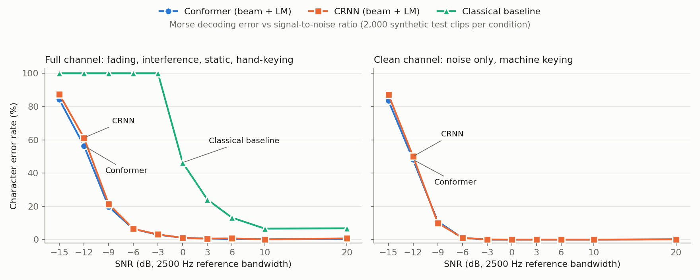

# Results (synthetic benchmark, 2 Oct 2026)

All numbers are **character error rate (CER)**. The test set is 2,000 synthetic clips per condition
(200 per SNR level), seed 2024, produced by `scripts/evaluate.py`. SNR is measured in a 2500 Hz reference bandwidth.

- **Full channel:** hand-keyed timing, Farnsworth spacing, Rayleigh/Rician fading, an interfering
  signal (QRM), static (QRN), chirp and drift. This is the training distribution.
- **Clean channel** (`--condition clean`): additive noise only, with machine-perfect keying.

| Model | Params | Training |
|---|---|---|
| Classical baseline (`morse/baseline.py`) | – | none: envelope detection, threshold, duration clustering |
| CRNN: CNN + 3×BiGRU + CTC | 3.6 M | 60k steps × 64 clips, ~7 h on an RTX 4050 laptop GPU |
| Conformer: CNN + 8-layer Conformer + CTC | 4.25 M | 45k steps × 64 clips (curriculum shortened), ~14 h in total (most of it before the attention-dropout speed fix) |

## Full channel: CER by SNR

| SNR (dB) | Baseline | CRNN greedy | CRNN beam+LM | Conformer greedy | Conformer beam+LM |
|---:|---:|---:|---:|---:|---:|
| -15 | 1.000 | 0.902 | 0.873 | 0.865 | **0.842** |
| -12 | 1.000 | 0.627 | 0.612 | 0.590 | **0.564** |
| -9 | 1.000 | 0.253 | 0.214 | 0.243 | **0.198** |
| -6 | 1.000 | 0.078 | 0.065 | 0.081 | **0.064** |
| -3 | 1.000 | 0.037 | 0.031 | 0.038 | **0.029** |
| 0 | 0.463 | 0.014 | **0.011** | 0.015 | **0.011** |
| +3 | 0.241 | 0.007 | **0.006** | 0.007 | **0.006** |
| +6 | 0.132 | 0.007 | 0.007 | 0.004 | **0.003** |
| +10 | 0.066 | 0.002 | 0.002 | 0.002 | **0.001** |
| +20 | 0.068 | 0.007 | 0.007 | **0.001** | 0.002 |
| **Overall CER** | 0.596 | 0.194 | 0.183 | 0.185 | **0.172** |
| **Overall WER** | 0.660 | 0.285 | **0.250** | 0.292 | 0.251 |

## Clean channel: CER by SNR

| SNR (dB) | CRNN greedy | CRNN beam+LM | Conformer greedy | Conformer beam+LM |
|---:|---:|---:|---:|---:|
| -15 | 0.900 | 0.872 | 0.853 | **0.836** |
| -12 | 0.538 | 0.500 | 0.538 | **0.481** |
| -9 | 0.134 | **0.100** | 0.151 | 0.109 |
| -6 | 0.015 | 0.011 | 0.015 | **0.010** |
| -3 … +10 | 0.000 | ≤0.001 | 0.000 | 0.000 |
| +20 | 0.001 | 0.001 | 0.001 | 0.002 |
| **Overall CER** | 0.152 | 0.142 | 0.150 | **0.138** |

## CER by speed (beam+LM)

| WPM | CRNN full | Conformer full | CRNN clean | Conformer clean |
|---|---:|---:|---:|---:|
| 10–20 | 0.136 | **0.118** | 0.129 | 0.122 |
| 20–30 | 0.166 | **0.161** | 0.140 | 0.136 |
| 30–40 | 0.192 | **0.181** | 0.146 | 0.143 |
| 40–50 | 0.217 | **0.204** | 0.146 | 0.140 |

## Findings

1. **The neural decoders beat the classical decoder by about 16 dB.** The baseline needs +10 dB to reach
   6.6% CER. Both networks reach the same error (6.4–6.5%) at **-6 dB**. Below -3 dB the baseline
   decodes nothing, while the networks still get 97% of characters right at -3 dB.
2. **The Conformer is slightly better than the CRNN, and only where the channel is hard.** On the full
   channel, overall CER is 17.2% vs 18.3% with beam+LM, with the largest gaps at -12 dB (56.4% vs 61.2%)
   and -9 dB (19.8% vs 21.4%). On the clean channel the two models are within noise of each other.
   So the Conformer's extra context helps with fading, interference and irregular timing, not with plain noise.
3. **Beam search with the character 4-gram LM helps most at moderate SNR:** about 4 points CER at -9 dB
   and about 6% relative overall. It makes no difference at high SNR.
4. **Below about -9 dB the limit is the noise itself, not the channel effects.** On the clean channel both
   models are error-free from -3 dB upwards, then fall off sharply: about 10% at -9 dB, about 50% at -12 dB.
   The channel effects add errors at every SNR (e.g. -6 dB: 1.0% → 6.4%) and roughly double CER at -9 dB.
5. **The loss of accuracy at high speed comes from the channel effects, not from speed itself.** On the
   clean channel CER is almost flat from 10 to 50 WPM. On the full channel it rises from 12% to 20%,
   because hand-keyed timing jitter and fading hurt short elements the most.
6. **Practical cost:** the CRNN trains about 1.5× faster on this GPU (150 vs 100 clips/s, even with the
   Conformer's attention-dropout speed fix). The Conformer's extra cost buys roughly 1 point of overall CER.

## Caveats

- These results are on **synthetic** audio from the same simulator used for training. The real-audio
  benchmark (`scripts/benchmark_real.py` on off-air beacon / W1AW recordings) is the next step, and the
  results that matter.
- With 200 clips per SNR, differences of about 1–2 points CER at a single SNR are within sampling noise.
  The model ranking relies on the gap being consistent across SNRs, decoders and the validation set.
- The baseline was not run on the clean channel in this table. Run `evaluate.py --baseline --condition clean` to add it.

## First real off-air test (2 Oct 2026): sim-to-real gap found

Data: 30 min of 14.100 MHz recorded from the VU24DX KiwiSDR (Kozhikode, Kerala; loop antenna on the ground),
14:49–15:19 UTC, sliced with `slice_beacons.py`. Alignment confidence was 1.76. 35 of 179 slots were detected,
mostly 4X6TU, 4S7B, 5Z4B, ZS6DN and OH2B: the paths open from Kerala towards Africa, the Middle East and Europe in the evening.

| measured SNR | n | Baseline | CRNN beam+LM | Conformer beam+LM | (synthetic CER at that SNR) |
|---|---:|---:|---:|---:|---:|
| -5 … 0 dB | 9 | 1.000 | **0.262** | 0.381 | 0.01–0.03 |
| -10 … -5 dB | 3 | 1.000 | **0.643** | 0.857 | 0.03–0.06 |
| -15 … -10 dB | 13 | 1.000 | 1.036 | 1.107 | 0.20–0.56 |
| -30 … -15 dB | 10 | 1.000 | 1.000 | 0.978 | 0.84+ |

**There's a large sim-to-real gap,** for example 26–38% CER on real audio vs 1–3% synthetic at -5…0 dB. On real audio the
CRNN beats the Conformer, which reverses the synthetic ranking. With n = 35, treat these as indicative only.

**Diagnosis**, from looking at the decodes, envelopes and spectrograms:
1. **Fast, deep fading.** On the 1-second 100 W dashes, the amplitude swings 20–34 dB within the second
   (std 4–8 dB), with the fading concentrated around 3 Hz. Whole dots and parts of dashes disappear, so characters
   get misread (X→6, B→5, 7→9). Simulator v1 faded only 30% of clips, at 0.05–1.5 Hz.
2. **Hallucinated text at low SNR.** Below about -10 dB both models output plausible ham phrases that are not
   there ("CQ CQ", "TEST", "TNX", "R R R"): the acoustic model learned a language prior and never saw
   "nothing decodable" during training (minimum training SNR was -14 dB).
3. **The baseline outputs nothing.** On real audio the on/off envelope separation (1.0–1.2) falls below its squelch (1.2).
   Relaxing the squelch only produces garbage, so the classical decoder genuinely fails here.

**Fix: simulator v2** (`configs/crnn_ft.yaml`, `configs/conformer_ft.yaml`). Fading on 60% of clips at 0.1–8 Hz
(log-uniform, Rician K 0–3); 5% noise-only clips with empty labels; SNR down to -20 dB; more random and
callsign text; variable receiver low-cut. Both models are fine-tuned from their v1 weights. Because this
recording was used to design v2, it is now a *development* set. **Final real-audio numbers must come from new
recordings** (other receivers or days).

### Simulator v2 fine-tune of the CRNN (3 Oct 2026): no measurable real-audio gain

`configs/crnn_ft.yaml`, 15k steps from `runs/crnn/best.pt`, about 1.5 h at 160–180 clips/s. CER on the v2 validation set
went from 0.187 to 0.175 (best at step 10k). The real-audio monitor CER (all 35 dev clips, mostly undecodable) went from 0.78 to 0.83.

Real dev clips, CER by measured SNR:

| measured SNR | n | CRNN v1 greedy | CRNN v1 beam+LM | CRNN-ft greedy | CRNN-ft beam+LM | Conformer v1 beam+LM |
|---|---:|---:|---:|---:|---:|---:|
| -5 … 0 dB | 9 | 0.310 | **0.262** | 0.333 | 0.310 | 0.381 |
| -10 … -5 dB | 3 | 0.714 | 0.643 | 0.643 | **0.571** | 0.857 |
| below -10 dB | 23 | ≈1.0 | ≈1.0 | ≈1.0 | ≈1.0 | ≈1.0 |

The two decodable bins move in opposite directions, and with only 12 decodable clips (about 50 characters), one character
changes CER by about 2 points. **This is no change within noise.** The errors also change type: v1 dropped or misread
the first character (`4X6TU` → `466TU`, `UX6TU`), while the fine-tuned model more often gets the first character right
but merges or splits characters (`4X6=U`, `4X6=`, `4XZTU`), which means it is mistiming the character gaps.

Conclusions:
1. A better fading model alone does not close the gap. The remaining mismatch is not captured by the simulator's
   current parameters (candidates: the receiver's AGC, noise that is not white, and the beacon keyer's exact timing).
2. **The dev set is too small to tell small improvements apart.** More real recordings (other receivers, times and
   bands) come before any further simulator changes. The Conformer v2 fine-tune is on hold until then.
3. The next experiment, once there are several recordings: fine-tune on real labelled beacon clips, holding out whole
   recordings for testing.

*(Conclusion 1 was revised the same day: see the next section. The fine-tune does help on a larger, independent recording.)*

## Second real recording (3 Oct 2026): South Australia, an independent test

Data: 30 min of 14.100 MHz from the Ironstone Range 2 KiwiSDR (VK5PH, South Australia; 12 m monopole), 20:09–20:39 UTC
(local dawn). Alignment confidence 4.35. **92 of 180 slots detected**, 14 beacons heard, from ZL6B at +10 dB down to
-20 dB. Neither the simulator v2 nor the fine-tune was designed on this recording, so it is an independent test of both.

**Before any change**, CER on the 42 decodable clips (measured SNR ≥ -10 dB, 195 characters):

| | CRNN v1 | CRNN-ft (v2) | Conformer v1 |
|---|---:|---:|---:|
| greedy | 0.313 | **0.256** | 0.308 |
| beam+LM | 0.308 | 0.262 | **0.256** |

The v2 fine-tune helps here: greedy CER falls from 31.3% to 25.6% (95% bootstrap CI of the difference: -9.9 to -1.5 points;
14 clips better, 4 worse). The first recording was simply too small (12 decodable clips) to show it. The Conformer, which lost to the
CRNN on the Kerala recording, matches the fine-tuned CRNN here.

All 7 clips at 0 dB or above are decoded perfectly by every system, including the classical baseline. The whole gap is at -10…0 dB.

### Fix: pad short clips to the training length

The models only ever saw **8-second** clips in training. The beacon clips are about **3 seconds** long. The most common error was
dropped characters, often at the start of the callsign (`VE8AT` → `8AT`, `4S7B` → `S7B`, `KH6RS` → `RS`). Padding each clip
to 8 s with noise that matches its own background (same spectrum, tone notched out; `morse/infer.py: pad_with_noise`)
fixes much of this. Most of the gain comes from padding *after* the clip; padding before it alone helps less.

CER on the same 42 clips, beam+LM (greedy in brackets):

| | CRNN v1 | CRNN-ft (v2) | Conformer v1 |
|---|---:|---:|---:|
| 3 s clips (before) | 0.308 (0.313) | 0.262 (0.256) | 0.256 (0.308) |
| padded to 8 s | 0.226 (0.221) | **0.174** (0.190) | 0.200 (0.226) |
| exact callsign match | 18/42 | **23/42** | 21/42 |

Full benchmark with padding (all 92 clips, beam+LM):

| measured SNR | n | CRNN v1 | CRNN-ft | Conformer v1 |
|---|---:|---:|---:|---:|
| 0 … +20 dB | 7 | 0.000 | 0.000 | 0.000 |
| -5 … 0 dB | 13 | 0.145 | **0.097** | 0.129 |
| -10 … -5 dB | 22 | 0.333 | **0.267** | 0.295 |
| -15 … -10 dB | 16 | 0.778 | 0.750 | **0.667** |
| -30 … -15 dB | 34 | 0.892 | 0.892 | **0.873** |

Padding is now the default in `transcribe_long` (so in `benchmark_real.py`, `decode_wav.py` and the training-time real
monitor); `benchmark_real.py --no-pad` reproduces the old numbers. On the small Kerala set (12 decodable clips) padding made
little difference either way.

**Combined effect on fresh real audio:** 30.8% → 17.4% CER at ≥ -10 dB (v2 fine-tune plus padding). The remaining gap to synthetic
audio is still large (synthetic CER is 1–6% at -10…0 dB). **Caveat:** the padding fix was found on this recording, so it is now
a development set too. The final test numbers must come from a third recording.

**Next:** fine-tune the Conformer on simulator v2 (`configs/conformer_ft.yaml`), since it matches the fine-tuned CRNN even
without v2. Also record a third receiver (Europe or Japan) as a held-out test set.

### Conformer v2 fine-tune (3 Oct 2026)

`configs/conformer_ft.yaml`, 15k steps from `runs/conformer/best.pt`, about 98 clips/s. Best CER on the v2 validation set is
0.163, against 0.175 for the fine-tuned CRNN.

Real audio, beam+LM, short clips padded to 8 s. Columns are the two recordings at measured SNR ≥ -10 dB:

| | South Australia (42 clips) | exact callsign | Kerala (12 clips) |
|---|---:|---:|---:|
| CRNN v1 | 0.226 | 18/42 | 0.393 |
| CRNN-ft | **0.174** | 23/42 | **0.375** |
| Conformer v1 | 0.200 | 21/42 | 0.518 |
| Conformer-ft | 0.179 | **24/42** | **0.375** |

- **The two fine-tuned models are tied on real audio.** Conformer-ft vs CRNN-ft on South Australia: +0.5 points CER, 95% CI
  -2.9 to +4.0; 2 clips better and 3 worse. The Conformer's better synthetic score does not carry over to real audio. The CRNN
  trains about 1.5× faster, so it is the practical choice.
- **Fine-tuning on v2 helps both architectures.** Its biggest effect is on the Conformer on the Kerala recording (0.518 → 0.375).
- **Simulator tuning has reached diminishing returns.** Both fine-tuned models sit at about 17–18% CER at -10…0 dB on real audio,
  against 1–6% on synthetic audio. The next gains should come from real training data (fine-tune on beacon clips from some
  recordings, test on others) rather than more simulator changes.
  Beacons send only 18 distinct callsigns, so a model trained on them could simply memorise them. The test set must hold
  out whole recordings, and ideally include non-beacon text (W1AW practice, hand-labelled QSOs).

## Held-out test: Wessex, UK (3 Oct 2026)

Data: 14.100 MHz from the `wessex.zapto.org` KiwiSDR (southern England), Saturday 13:17–15:16 UTC. The receiver drops
listeners every ~15 min, so the audio is in 10 pieces. Four pieces (13:17, 13:48, 13:57, 14:02 UTC) could not be aligned
(offsets of -2.2, +5.9, -5.4 and -7.9 s against ~0.0 for the rest, and their power ladders were nonsense) and were left out.
The six aligned pieces (confidence 1.9–3.2) give **216 detected beacon clips, 112 at ≥ -10 dB**, listed in
`real_data/test_wessex.csv`. No design decision was made on this data before the numbers below were computed, so this is the
held-out test set. (Two other attempts this morning, from a Dutch-proxy and a Japanese receiver, heard no beacons: the band was
closed. The slicer now warns about this.)

CER, beam+LM, clips padded to 8 s:

| measured SNR | n | Baseline | CRNN v1 | CRNN-ft | Conformer v1 | Conformer-ft |
|---|---:|---:|---:|---:|---:|---:|
| ≥ 0 dB | 83 | 0.978 | **0.297** | 0.314 | 0.303 | 0.314 |
| -10 … 0 dB | 29 | 1.819 | **0.732** | 0.768 | 0.833 | 0.920 |
| exact callsign (all 112) | | 38 | 47 | 46 | **50** | 46 |

**Much worse than the Australia recording** (0% CER at ≥ 0 dB there), and the v2 fine-tunes give **no improvement**:
CRNN-ft vs CRNN v1 at -10…0 dB is +3.6 points, 95% CI -5.2 to +12.5; Conformer-ft vs Conformer v1 is +8.7, CI -1.5 to +19.6.

**Cause: strong interference from other stations.** On a Saturday evening the European 20 m band is busy. Spectrograms show other CW
signals 100–500 Hz from the beacon, often as strong as it. Splitting the clips by the strongest *other* narrowband peak
in the audio (≥ 15 dB above the noise floor = "busy"):

| | ≥ 0 dB quiet (39) | ≥ 0 dB busy (44) | -10…0 quiet (12) | -10…0 busy (17) |
|---|---:|---:|---:|---:|
| CRNN v1 | 0.126 | 0.446 | 0.456 | 0.926 |
| CRNN-ft | 0.120 | 0.482 | 0.421 | 1.012 |
| Conformer v1 | 0.120 | 0.461 | 0.439 | 1.111 |
| Conformer-ft | **0.102** | 0.497 | **0.386** | 1.296 |

In busy clips the models often decode the wrong station (`OH2B` → `TU 4`; `TEST`, `VVV` appear). Simulator v1/v2 only ever added
interference 3–20 dB *weaker* than the target, so the models never learned which of two strong signals to follow. On quiet
clips the fine-tuned models are slightly better, consistent with the Australia result.

**Narrow filtering does not fix it.** A 4th-order band-pass centred on the beacon (the slicer moves it to 700 Hz) at 200 / 120 / 80 Hz
width gave CRNN v1 CER at ≥ 0 dB of 0.272 / 0.300 / 0.383 (vs 0.297 unfiltered), and made CRNN-ft worse. The interferers are
too close, and sharp filters smear element timing.

**Next: simulator v3, "decode the signal in the middle".** Fix the target pitch to a narrow window (e.g. 700 ± 50 Hz, which the slicer
and `decode_wav.py --auto-center` already provide), and add 1–3 interfering CW signals 50–500 Hz away at -20 to +10 dB
relative to the target, sending realistic text (CQ, TEST, contest exchanges). This test set has now been used for diagnosis, so
v3 needs a fresh held-out recording for its final numbers. A quiet-band and a busy-band test set should be reported separately.

## Simulator v3 fine-tune and the final held-out test (4 Oct 2026)

**v3 fine-tune** (`configs/crnn_ft3.yaml`, 15k steps from CRNN-ft, ~1.9 h): v3 validation CER 0.190. The real-audio monitor
on the Wessex clips (greedy) stayed flat: 0.448 before, 0.430 at the end.

**Final test: a new region.** Fayetteville, Georgia, USA KiwiSDR (`22017.proxy.kiwisdr.com`, RF-PRO-1 active antenna),
Saturday 19:47–20:17 UTC (afternoon there), in 3 pieces (the receiver drops listeners), all aligned (confidence 1.7–2.7). It produced
45 detected clips, 20 at ≥ -10 dB (4U1UN ×10, CS3B ×8, OA4B ×2). None of them were busy: no strong interferers. Nothing was
tuned on this recording. Note: the receiver's tuning was ~170 Hz off (tone at 871 Hz). The slicer found it within the new 500–900 Hz search
range and moved it to 700 Hz.

CER, beam+LM, padded (whole callsigns correct in brackets):

| measured SNR | n | Baseline | CRNN v1 | CRNN-ft | CRNN-ft3 | Conformer v1 | Conformer-ft |
|---|---:|---:|---:|---:|---:|---:|---:|
| ≥ 0 dB | 9 | 0.044 (8) | **0.000 (9)** | **0.000 (9)** | 0.044 (7) | **0.000 (9)** | **0.000 (9)** |
| -10 … 0 dB | 11 | 0.844 (1) | 0.400 (4) | 0.378 (5) | 0.600 (2) | 0.444 (3) | **0.311 (4)** |
| all ≥ -10 dB | 20 | 0.444 (9) | 0.200 (13) | 0.189 (14) | 0.322 (9) | 0.222 (12) | **0.156 (13)** |

- Neural vs classical: CRNN v1 is 24 points better than the baseline (95% CI -40 to -11).
- **v3 is significantly worse** than CRNN v1 on this quiet-band test (+12.2 points, CI +4.4 to +21.6; 0 clips better, 7 worse).
  It drops leading characters even at +9 dB (`4U1UN` → `U1UN`) and outputs `CQ` for weak targets, which is the interferers' text leaking into the output.

**Pooled held-out set.** No model except CRNN-ft3 was influenced by the Wessex recording (it was recorded after they were fixed), so
Wessex and the US recording together form a 132-clip held-out set for the first five systems:

| clips (≥ -10 dB) | n | Baseline | CRNN v1 | CRNN-ft | Conformer v1 | Conformer-ft | (CRNN-ft3, dev) |
|---|---:|---:|---:|---:|---:|---:|---:|
| all | 132 | 1.094 (47) | **0.384 (60)** | 0.401 (60) | 0.415 (62) | 0.432 (59) | 0.423 (61) |
| quiet band | 71 | 0.949 (33) | 0.207 (44) | 0.194 (46) | 0.207 (45) | **0.169 (46)** | 0.236 (41) |
| quiet, -10 … 0 dB | 23 | 1.735 (1) | 0.431 (6) | 0.402 (7) | 0.441 (5) | **0.353 (6)** | 0.500 (4) |
| busy band | 61 | 1.259 (14) | **0.588 (16)** | 0.639 (14) | 0.653 (17) | 0.734 (13) | 0.639 (20) |

(Baseline CER above 1 means it outputs more wrong characters than the reference contains: on real audio it mostly decodes noise.)

**Conclusions**
1. **The neural decoders beat the classical decoder on held-out real audio**: 38% vs 109% CER overall (CI of the difference
   -96 to -49 points). In quiet conditions the best model (Conformer-ft) reaches **17% CER, against 95%** for the classical decoder.
2. **Simulator v2 helps in quiet conditions**: Conformer-ft beats Conformer v1 and CRNN v1 on the quiet held-out clips
   (vs CRNN v1: -3.8 points, CI -6.5 to -1.6).
3. **Busy bands are unsolved.** Every model is at 59–73% CER when other strong stations are near the target, and v2 makes this
   slightly worse.
4. **Simulator v3 (negative result)**: adding 1–3 interferers up to +10 dB did not fix busy-band decoding (0.639, same as CRNN-ft) and
   damaged quiet-band decoding. Likely causes: interferers sending the same kind of text (CQ, contest), so the model learns to copy
   whichever signal is clearest; and fine-tuning only 15k steps from a model that had never had to pick a signal by pitch. Ideas for next time:
   condition the model explicitly on the target pitch (e.g. a pitch-offset input channel), mix in the real busy-band clips
   with schedule labels, or separate signals before decoding (detect each tone, then decode each one). **CRNN-ft3 is not recommended.**
5. Recommended models: **Conformer-ft** for normal (quiet) conditions; CRNN v1 is the most robust on busy bands.
